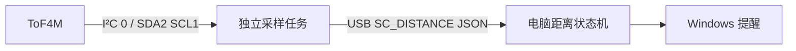

# StackChan 距离提醒

在 M5Stack 原厂固件基础上采集 ToF4M 距离，通过 USB 送到 Windows，持续过近时提醒。
沿用 StackChan + Unit ToF4M（U172 / VL53L1X），不更换原厂软件路线。

## 接线与摆放

关机后，用附带 Grove 线连接 ToF4M 与机器人**机头左侧、USB-C 下方的红色 PORT A**。
顶部蓝色 PORT C 是 UART，黑色 PORT B 是 GPIO，本功能不接这两个口。
PORT A：黑 GND、红 5V、黄 SDA/GPIO2、白 SCL/GPIO1。

ToF4M 白壳凹槽中的两个光学窗口朝向被测目标，窗口保持无遮挡。
第一版将模块固定在屏幕附近、保持朝向稳定；若装在会转动的头部，当前距离判断不会识别转头，需另做姿态门控。
读数是传感器到目标表面的距离，不直接等于眼睛到屏幕的距离，安装后需调整阈值。

[机器人接口图](https://m5stack-doc.oss-cn-shenzhen.aliyuncs.com/1205/K151_stack_chan_main_pictures_02.webp) ·
[ToF4M 正面与引脚](https://docs.m5stack.com/zh_CN/unit/Unit_ToF4M)

## 第一版数据路径



- 采样任务跨菜单与 AI 模式持续运行，独占外部 I²C 控制器 0；内部控制器 1 保持原用途。
- 固件只发布新测量和传感器状态，未接传感器或读取失败不会阻止原厂主程序启动。
- 电脑对三个有效新样本取中值。默认低于 **40 cm** 开始累计，持续 **5 秒** 提醒；恢复到 **48 cm** 解除过近状态，持续过近时提醒间隔至少 **60 秒**。
- 无效测量、断连和采样间隔超过 1.5 秒都会清除滤波与过近累计；恢复后重新采满三个有效样本并累计。
- 参数在电脑端配置并保存；USB 当前为单向日志，不向机器人发送命令。
- 首版提供电脑通知和可选电脑提示音；机器人表情/声音联动尚未接入。

## Windows 使用

先完成下面的固件构建与部署。确认机器人已运行含距离采样的固件后，双击根目录
`Start-DistanceReminder.cmd`，或从项目目录运行：

```powershell
.\scripts\Start-DistanceReminder.ps1

# 串口存在多个设备时指定端口；串口号以当前系统为准
.\scripts\Start-DistanceReminder.ps1 -Port COM38

# 修改并保存参数；这些是可调示例，不是医学建议
.\scripts\Start-DistanceReminder.ps1 -ThresholdCm 40 -HysteresisCm 8 -HoldSeconds 5 -CooldownSeconds 60

# 开/关电脑提示音
.\scripts\Start-DistanceReminder.ps1 -Sound
.\scripts\Start-DistanceReminder.ps1 -NoSound

# 完全不连接机器人，用模拟读数演示提醒
.\scripts\Start-DistanceReminder.ps1 -Simulate
```

控制台显示连接、读数与状态；按 **P** 暂停/继续，按 **Q** 退出。
设置保存在本地 `pc/reminder-settings.json`（Git 忽略）；模拟模式不会保存配置或访问串口。
普通固件日志不会被打印或存入提醒日志。系统勿扰/专注设置可能隐藏通知气泡，控制台仍有 `ALERT`。

串口按已有采集方式设置 DTR/RTS，但不同驱动下打开端口仍可能引发设备复位。
自动选择仅在唯一匹配的 ESP32-S3 USB 设备存在时进行，多台时使用 `-Port`。

## 开发与验证

```powershell
# 主机状态机/协议测试与无通知模拟，不操作机器人
.\scripts\Test-DistanceReminder.ps1

# 运动数学和 ToF 寄存器驱动测试，使用模拟 I²C
.\scripts\Test-Host.ps1

# 构建完整 ESP-IDF 固件，不刷写
.\scripts\Build-Firmware.ps1
```

固件入口：`StackChan/firmware/main/distance_sensor/`。
电脑入口：`pc/distance_reminder/`；通知使用 Windows 自带 PowerShell/WinForms。
工具链与已有依赖均沿用 [DEVELOPMENT.md](DEVELOPMENT.md)，没有新增 Python 包或 Arduino 框架依赖。
ToF 寄存器驱动依据 ST 官方代码改编，来源与许可保留在其目录。

构建成功、模拟通过与真实传感器/Windows通知验证是不同结果。
首次部署前应备份设备现有内容并确认刷写方案；现有构建脚本只编译，不自动刷写。
原厂在线更新可能覆盖本地新增功能，升级前需保留本地修改。

## 本地 Git

根仓库记录电脑端、脚本、文档及固件子仓库指针，`StackChan/` 保留原厂 Git 历史。
两个仓库的开发分支均为 `feature/distance-reminder`；自有改动只提交到本地，未推送上游。
工具、构建产物、日志和本地设置不提交。迁移本地项目时要同时保留根仓库与固件子仓库的提交。

原始交接：[STACKCHAN_HANDOFF.txt](STACKCHAN_HANDOFF.txt) ·
环境记录：[environment.json](environment.json) ·
网络排查：[WIFI_DIAGNOSIS.md](WIFI_DIAGNOSIS.md) ·
蓝牙演示：[demos/stackchan-ble/README.md](demos/stackchan-ble/README.md)
