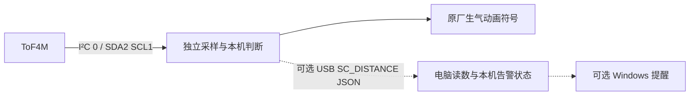

# StackChan 距离提醒

机器人独立采集 ToF4M 距离，持续过近时在原厂脸旁显示“生气”动画符号，移远后解除。
日常表情提醒不依赖电脑、USB 数据线或网络；电脑端保留读数同步与可选 Windows 通知。
沿用 StackChan + Unit ToF4M（U172 / VL53L1X），不更换原厂软件路线。

## 接线与摆放

关机后，用附带 Grove 线连接 ToF4M 与机器人**机头左侧、USB-C 下方的红色 PORT A**。
顶部蓝色 PORT C 是 UART，黑色 PORT B 是 GPIO，本功能不接这两个口。
PORT A：黑 GND、红 5V、黄 SDA/GPIO2、白 SCL/GPIO1。

ToF4M 白壳凹槽中的两个光学窗口朝向被测目标，窗口保持无遮挡。
按当前摆放方案，将模块固定在电脑屏幕边框，朝向平时坐的位置，连接线留出机器人转头所需的余量。
若以后改装在会转动的头部，当前距离判断不会识别转头，需另做姿态门控。
读数是传感器到目标表面的距离，不直接等于眼睛到屏幕的距离，安装后需调整阈值。

[机器人接口图](https://m5stack-doc.oss-cn-shenzhen.aliyuncs.com/1205/K151_stack_chan_main_pictures_02.webp) ·
[ToF4M 正面与引脚](https://docs.m5stack.com/zh_CN/unit/Unit_ToF4M)

## 数据与提醒路径



- 采样任务跨菜单与 AI 模式持续运行，独占外部 I²C 控制器 0；内部控制器 1 保持原用途。
- 固件对三个有效新样本取中值。默认低于 **40 cm** 开始累计，持续 **5 秒** 显示生气符号；恢复到 **48 cm** 解除。持续过近时符号保持显示，不周期播放提示音。
- 提醒复用原厂 `AngryDecorator`，由现有显示更新线程在 LVGL 锁内管理；原表情、眨眼和对话继续运行，解除时移除符号，不回放旧的表情或眼嘴控制指令。
- 可在原厂主菜单打开 **DANCE** 测试，不需要连接蓝牙；AVATAR 与 AI 模式显示原厂脸时也接入同一提醒。主菜单、没有脸的界面或脸完全隐藏的来电界面不显示符号。
- 无效测量、传感器断连和采样间隔超过 1.5 秒都会清除本机滤波、累计和提醒；恢复后重新采满三个有效样本并累计。未接传感器不会阻止原厂主程序启动。
- `SC_DISTANCE` v1 保留原始距离、有效性、序号、设备时间和错误状态，并追加 `robot_alert` 布尔值。电脑端同时显示原始读数和本机告警状态，旧协议仍兼容；`robot_alert` 表示本机规则满足，实际符号还取决于当前是否显示脸。
- 电脑端可另行开启 Windows 通知；其规则与参数独立运行，默认提醒间隔至少 **60 秒**。关闭电脑程序不会停止机器人本机提醒。

## USB、Wi-Fi 与参数

机器人只要正常供电、ToF 连着 PORT A，即可在部署此固件后独立提醒。
USB 仅用于当前的首次开发测试、日志和可选电脑同步；固定在最终位置时可以不连接电脑 USB。

当前机器人阈值、迟滞和持续时间取自固件 `distance_sensor/proximity_policy.h` 的默认配置。
下面的电脑命令只调整电脑端规则，**不会修改机器人规则**。机器人无线改参、Wi-Fi 距离同步和电脑直接触发的局域网 OTA 入口尚未实现。

原厂源码已有固件 OTA 和 AI 用户工具 `self.upgrade_firmware(url)`，但触屏更新页没有输入任意本地固件 URL 的入口。
现机旧版本和当前平台能否调用该工具尚未验证，因此不声称首次技术上必须 USB；现阶段先在近处通过 USB 备份、部署和测通，是可控的开发路径。
OTA 机制见 [ESP-IDF 文档](https://docs.espressif.com/projects/esp-idf/en/v5.5.4/esp32s3/api-reference/system/ota.html)。

## Windows 使用

先完成下面的固件构建与部署。确认机器人已运行含距离采样的固件后，双击根目录
`Start-DistanceReminder.cmd`，或从项目目录运行：

```powershell
.\scripts\Start-DistanceReminder.ps1

# 串口存在多个设备时指定端口；串口号以当前系统为准
.\scripts\Start-DistanceReminder.ps1 -Port COM38

# 只查看同步信息，使用机器人表情提醒
.\scripts\Start-DistanceReminder.ps1 -NoNotify

# 只修改并保存电脑端参数；这些是可调示例，不是医学建议
.\scripts\Start-DistanceReminder.ps1 -ThresholdCm 40 -HysteresisCm 8 -HoldSeconds 5 -CooldownSeconds 60

# 开/关电脑提示音
.\scripts\Start-DistanceReminder.ps1 -Sound
.\scripts\Start-DistanceReminder.ps1 -NoSound

# 完全不连接机器人，用模拟读数演示提醒
.\scripts\Start-DistanceReminder.ps1 -Simulate
```

控制台显示连接、读数、`robot_alert=on/off/unknown` 与电脑端状态。
按 **P** 只暂停/继续电脑端判断，按 **Q** 退出电脑程序，均不暂停机器人本机提醒。
设置保存在本地 `pc/reminder-settings.json`（Git 忽略）；模拟模式不会保存配置或访问串口。
普通固件日志不会被打印或存入提醒日志。系统勿扰/专注设置可能隐藏通知气泡，控制台仍有 `ALERT`。

串口按已有采集方式设置 DTR/RTS，但不同驱动下打开端口仍可能引发设备复位。
自动选择仅在唯一匹配的 ESP32-S3 USB 设备存在时进行，多台时使用 `-Port`。

## 开发与验证

```powershell
# 主机状态机/协议测试与无通知模拟，不操作机器人
.\scripts\Test-DistanceReminder.ps1

# 运动数学和 ToF 寄存器驱动测试，使用模拟 I²C
.\scripts\Test-Host.ps1

# 构建完整 ESP-IDF 固件，不刷写
.\scripts\Build-Firmware.ps1
```

固件入口：`StackChan/firmware/main/distance_sensor/`。
电脑入口：`pc/distance_reminder/`；通知使用 Windows 自带 PowerShell/WinForms。
工具链与已有依赖均沿用 [DEVELOPMENT.md](DEVELOPMENT.md)，没有新增 Python 包或 Arduino 框架依赖。
ToF 寄存器驱动依据 ST 官方代码改编，来源与许可保留在其目录。

构建成功、模拟通过与真实传感器/Windows通知验证是不同结果。
首次部署前应备份设备现有内容并确认刷写方案；现有构建脚本只编译，不自动刷写。
原厂在线更新可能覆盖本地新增功能，升级前需保留本地修改。

## 本地 Git

根仓库记录电脑端、脚本、文档及固件子仓库指针，`StackChan/` 保留原厂 Git 历史。
两个仓库的开发分支均为 `feature/distance-reminder`；自有改动只提交到本地，未推送上游。
工具、构建产物、日志和本地设置不提交。迁移本地项目时要同时保留根仓库与固件子仓库的提交。

原始交接：[STACKCHAN_HANDOFF.txt](STACKCHAN_HANDOFF.txt) ·
环境记录：[environment.json](environment.json) ·
网络排查：[WIFI_DIAGNOSIS.md](WIFI_DIAGNOSIS.md) ·
蓝牙演示：[demos/stackchan-ble/README.md](demos/stackchan-ble/README.md)
