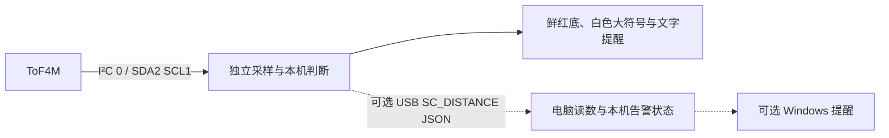

# StackChan 距离提醒

机器人按日程与临时开关独立采集 ToF4M 距离，平时显示动态表情，监测开启时过近会显示整屏鲜红底、白色大警告图形和 “TOO CLOSE”，移远后解除。
测距与表情在机器人本机运行，无需电脑或 USB 数据线；日程需要有效时钟，歌词与 Codex 额度查询需要机器人联网。电脑端保留读数同步与可选 Windows 通知。
沿用 StackChan + Unit ToF4M（U172 / VL53L1X），不更换原厂软件路线。

**当前版本：113（2026-11-11 已无线安装）。** 修正手机滚动歌词标题造成的查询重置、读取中重复蓝牙通知和源别名匹配；内容正确但时间不符时显示 `TIMING?`。从 LIVE 自动完成两段 Wi-Fi 更新，独立确认目标 ELF、`ota_1` 与 `VALID`，原 MUSIC 已恢复、手机重连，实机当前歌曲1799ms取回70行同步歌词；无需用户预先 RST、HOME 或 USB。保留112刷卡切换提醒及既有优先级；当前歌曲实测与固定回归不代表整个歌单覆盖率，实体LCD目视与历史OTA根因仍有边界。
使用说明见本文，开发入口见 [DEVELOPMENT.md](DEVELOPMENT.md)，安装与验证边界见 [DEVICE_DEPLOYMENT.md](DEVICE_DEPLOYMENT.md)，可复用教训见 [EXPERIENCE.md](EXPERIENCE.md)。文档引用的 `.tools/`、`logs/` 是未上传的本地原始证据，公开仓库提供其结论与范围说明。

**BOTIFIER（原 DISTANCE）集中显示距离提醒、歌词、护眼倒计时与 Codex 周额度。** 轮播仅在该应用 LIVE 页显示，主菜单和 AI 界面不显示栏目。**NFC片头与完整护眼流程并列最高、互不打断；其后依次是摸头互动、过近提醒及其循环摇头、歌词、普通信息。** 暖色时钟与冷色额度仪表盘各展示12秒，中间纯表情各3秒；到点依次播放守岸人3D短片、节奏摇头表情，最后开始20秒休息倒计时。距离监测开启期间在后台采样。

## 接线与摆放

关机后，用附带 Grove 线连接 ToF4M 与机器人**机头左侧、USB-C 下方的红色 PORT A**。
顶部蓝色 PORT C 是 UART，黑色 PORT B 是 GPIO，本功能不接这两个口。
PORT A：黑 GND、红 5V、黄 SDA/GPIO2、白 SCL/GPIO1。

ToF4M 白壳凹槽中的两个光学窗口朝向被测目标，窗口保持无遮挡。
按当前摆放方案，将模块固定在电脑屏幕边框，朝向平时坐的位置，连接线留出机器人转头所需的余量。
若以后改装在会转动的头部，当前距离判断不会识别转头，需另做姿态门控。
读数是传感器到目标表面的距离，不直接等于眼睛到屏幕的距离，安装后需调整阈值。

[机器人接口图](https://m5stack-doc.oss-cn-shenzhen.aliyuncs.com/1205/K151_stack_chan_main_pictures_02.webp) ·
[ToF4M 正面与引脚](https://docs.m5stack.com/zh_CN/unit/Unit_ToF4M)

## 数据与提醒路径



- 自动日程为**北京时间周一至周五 09:30–21:30**，不包含节假日或调休工作日规则。其他时段默认停测；周末 09:30–21:30 内摸头可开启到当天 21:30。NFC 可临时切换，规则见下节；无有效时钟显示 `CLOCK WAIT`，不采样，也不预排临时开启。
- 采样服务跨菜单与 AI 模式保留，但只在日程或临时开关开启时测距；关闭会停止传感器、清除旧滤波和告警，再开启后等待新样本。服务独占外部 I²C 控制器 0；内部控制器 1 保持原用途。
- 固件对三个有效新样本取中值。默认中值低于 **40 cm** 就显示提醒，等待时间 **0 秒**；恢复到 **48 cm** 解除。采样约 10 Hz，仍有采样与中值滤波延迟，不能把“0 秒等待”理解为 LCD 零延迟。持续过近时保持红色提醒；在 BOTIFIER LIVE 中，机头小幅左摆回中、右摆回中，停顿后持续循环，距离恢复或数据失效即停止，不周期播放提示音。摸头、NFC、护眼及打开菜单会先停止这项低优先级动作，结束后若仍过近再恢复。
- 提醒采用整屏鲜红底、80×80 px白色警告图形和约36 px白色文字，不频闪。顶部下滑或底部上滑可调出菜单；NFC与护眼动画完整播放后，若仍过近再显示红底。显示线程在LVGL锁内管理，原表情、眨眼和对话后台继续运行；解除时移除自有提示图层，不回放旧的表情或眼嘴控制指令。
- 在原厂主菜单打开 **BOTIFIER**，默认显示电子宠物脸：眨眼、回看，以及开心、撒娇、委屈等情绪动作；DANCE、AVATAR 与 AI 模式显示原厂脸时也接入同一提醒。主菜单、没有脸的界面或脸完全隐藏的来电界面不显示符号。
- 无效测量、传感器断连和采样间隔超过 1.5 秒都会清除本机滤波、累计和提醒；恢复后重新采满三个有效样本并累计。未接传感器不会阻止原厂主程序启动。
- `SC_DISTANCE` v1 保留原始距离、有效性、序号、设备时间和错误状态，并提供 `robot_alert`、`monitoring`、`schedule` 等状态。电脑端同时显示原始读数和本机告警状态，旧协议仍兼容；`robot_alert` 表示本机规则满足，实际符号还取决于当前是否显示脸。
- 电脑端可另行开启 Windows 通知；其规则与参数独立运行，默认提醒间隔至少 **60 秒**。关闭电脑程序不会停止机器人本机提醒。

## 机器人表情与实时调参

在原厂主菜单左右滑到紫色 **BOTIFIER** 并点击进入；这是原来的 DISTANCE 入口，无需应用市场、电脑程序或网络。

- **LIVE**：全屏电子宠物与轮播栏目；过近时显示全屏红色提醒。顶部向下滑或底部向上滑打开菜单，查看实时距离、NFC和护眼状态；右侧 **BAT 75%** 是电量，**75% CHG** 表示充电，读数不可用显示 **BAT --**。**HOME** 返回主菜单，**DISTANCE / NFC / PROGRAMS** 直接进入对应设置。
- **摸头互动**：在 LIVE 轻触头顶，机器人依次注意、开心回应、短暂停留、自然收尾，约3秒；短时间再摸会换成撒娇回应。按住或同一次前后抚摸不会重复启动。**互动和动作展示优先于 TOO CLOSE，TOO CLOSE 优先于闲时栏目**；过近时也能摸头，动作结束后按当前距离恢复提醒。NFC和整段护眼的既有保护规则保留，忙时的触摸直接丢弃、不补播；摸头不依赖外置 ToF 有效读数。
- **连续触摸保护**：连续互动最多6秒，达到上限后至少2秒不接受触摸重启，避免一直遮住歌曲等信息。4秒内第三次确认接触会暂停接收摸头，触摸信号连续有效归零2秒后自动恢复；正常单摸、二次撒娇、长按和滑动保留。异常期间暂不响应摸头，不代表触摸芯片的误报来源已经消除。
- **摸头输入校准**：seq92采用LOW5、仅开启三路头顶电极，保留sleep。自动对照中LOW3→5→3的非零计数为113/480→0/480→129/480；正式版随后两分钟静置采样原始边沿和误触均0、隔离关闭。真实摸头灵敏度及电气信号来源仍待验证，完整范围见[部署记录](DEVICE_DEPLOYMENT.md)。
- **DISTANCE**：**F** 为中值、**R** 为原始距离（cm），后接有效性与状态。按三行 **− / +** 修改参数，下一帧测距应用；通过手势菜单的 **LIVE** 返回看效果。读数每 100 ms 刷新。
- **SAVE**：显式保存当前参数；成功或错误会显示在页面上。未保存参数可以跨 LIVE/TUNE 和菜单切换保留，但重启后恢复已保存值。

| 参数 | 默认 | 操作 |
| --- | --- | --- |
| 距离阈值 | 40 cm | 每次调 1 cm；中值低于它才触发 |
| 恢复余量 | 8 cm | 每次调 1 cm；恢复距离 = 阈值 + 余量，减少边界反复闪烁 |
| 触发等待 | 0.0 秒 | 每次调 0.1 秒；0 表示中值越线后不再额外等待 |

例如 40 cm / 8 cm：中值低于 40 cm 触发，达到 48 cm 解除；进入提醒后，40–48 cm 区间保持提醒。
调参后会重置本次触发计时，在下一帧有效数据上重新判断；不会把之前积累的时间算到新设置上。
无效或超过 1.5 秒未更新时显示不可用并清除提醒，不将旧距离当作实时距离。
调参页不显示脸；LIVE 与其他脸部界面使用同一份本机判定。

电子宠物会在平静停留之间穿插好奇、开心、撒娇、害羞、委屈、困倦、惊讶和单眼眨；开心有笑眼与弹跳，撒娇有侧摆与腮红，委屈有垂眼、小弯嘴和泪滴。动作使用约 280 ms 平滑转场，普通表情最多约 30 Hz 更新；告警信号变化绕过动画节流。恢复安全后短暂放松再回到日常动作；读数无效时回到安静表情，不播放庆祝。

日常随机表情改变屏幕五官；主动摸头回应和护眼到期另有实体转头/点头。真实距离仍由原有采样和阈值判断。浏览器[动作设计与实际固件渲染预览](demos/face-lab/README.md)可以单独查看；实际 LVGL 图集包含开心、撒娇、委屈与告警切换动画，属于桌面渲染，不是机器人 LCD 实拍。

## NFC 刷卡切换距离提醒并播放片头

使用机身内置 ST25R3916 读取 NFC-A 卡片 UID，不写卡片存储。112 中，每次获准的新刷卡**先切换距离提醒，再全屏播放 3.4 秒黑底 KURO GAMES Logo**；持卡只切换一次，片头启动失败也不撤销已生效的开关。素材取自[库洛 PGR 官网](https://pgr.kurogame.net/)公开宣传片，保留原始淡入淡出；该片头区间静音。来源、转换方法与文件摘要见 [media/README.md](StackChan/firmware/main/apps/app_distance/media/README.md)。此前版本已读到随附卡片；112 的实体刷卡与片头目视尚未验收，精确感应距离与其他卡片兼容性未测。

临时开关持续到下一个北京时间 **09:30 或 21:30**：白天到当晚 21:30，夜间跨午夜到次日 09:30，然后回到自动日程。摸头不会推翻 NFC 暂停；临时状态不保存到 NVS，重启后回归日程。没有有效时钟时不切换或预排开关，片头仍可触发。

进入 **BOTIFIER**，顶部下滑或底部上滑打开菜单，选择 **NFC**；确认 **READER ON** 后通过菜单回 **LIVE**，将卡片靠近机身 NFC 感应区。**无需满足任何测距条件**：过近、读数无效或过期均可刷卡。NFC片头或完整护眼流程占用期间的刷卡直接消费，不切换、不排队、不重播或延长。NFC播放结束后移开卡片约1秒，再重新刷卡。程序要求至少两次有效无卡读数、跨度达到300ms；读卡错误不算移卡。

播放默认占满320×240，没有常驻HOME或状态条。手势菜单的 **HOME** 可中止播放并返回主菜单；仅打开菜单或按 **CLOSE** 不会中断动画。距离状态不会阻止或中断片头；切换为 ON 后后台恢复采样，切换为 OFF 后停止采样并清除旧告警。本功能不再运行麦克风监听和摄像头手检测。

| 控件/读数 | 含义 |
| --- | --- |
| READER ON/OFF | 本功能读卡开关，仅保存在内存；重启恢复 ON |
| DISTANCE ON/OFF / CLOCK WAIT | 距离监测开启、关闭或等待有效时钟；抽屉中的 PAUSED 表示 NFC 临时关闭 |
| READS / TRIG | 读卡尝试次数 / 接受的触发次数；尝试次数不等于成功刷卡次数 |
| UID | 最近读取的卡片标识，支持4、7或10字节 NFC-A UID |
| NFC TAP CARD / MOVE CARD AWAY | 可刷卡 / 需要移开卡片重新准备 |
| NFC STARTING / READER ERROR | 初始化 / 读卡异常 |

`SC_NFC` v1 以约2Hz输出读卡状态、错误码、计数与UID快照；重复快照不代表独立刷卡事件。原有 `SC_DISTANCE` 与电脑距离同步继续使用。旧响指版本的失败、改动和实测记录保存在部署文档中。

## iPhone 歌词

通过 BLE Apple Media Service（AMS）读取手机媒体信息，由机器人独立联网向 LRCLIB、网易云及酷狗取词，声音仍走手机原来的输出设备。入口为 **BOTIFIER → 手势菜单 → MUSIC**。歌词位于 NFC、护眼、摸头与距离提醒之后，普通信息轮播之前，不推迟护眼时钟。

112 沿用 111 的通用匹配修复：核对完整歌曲身份、版本与时长，处理重复来源 ID、坏候选及部分播放器把当前歌词放进标题的输入；没有逐歌补丁。未通过时间校准但内容合法的歌词保留完整原文与时间点，显示 **TIMING?** 并按原时间轴滚动，不缩放或裁尾，也不宣称准确同步。左右点击可临时浏览，继续播放6秒后回到当前句；暂停冻结、seek跟随，插播后保留浏览位置。

固定16首目录样本回放达到16/16 Synced、6个不同版本反例全部拒绝，属于限定样本验证，不能代表用户歌单覆盖率。本轮112安装后已恢复 MUSIC 开关并验证重连，但未完成新一轮实机取词、滚动与 LCD 验收。使用步骤、匹配边界和历史实测见 [LYRICS.md](LYRICS.md)；[浏览器效果稿](demos/lyrics-lab/README.md)可单独查看。

## 空闲轮播：护眼倒计时与 Codex 周额度

只有 **BOTIFIER → LIVE** 内轮播；离开应用立即清除节目，主菜单和AI待机不显示。NFC片头和护眼动画并列最高，先开始的完整播放；其后依次是摸头、过近提醒、歌词和普通栏目。进入调参暂停栏目，前台结束后连续空闲10秒才恢复。在距离监测开启期间，采样与阈值判断独立于栏目播放运行。

- **NEXT EYE BREAK**：暖琥珀色时钟与大号 **MM:SS**，默认从20:00开始，换栏目时持续走时。到点依次播放 **3.8秒守岸人3D短片 → 12.7秒机器人归正与往返动作 → REST 20秒**。先用0.7秒回到校准正面，再让左、右、上、下各做两次完整往返，每组回中后短暂停；左右围绕校准正面最多约±8°、俯仰约±4°，按实时舵机限幅。REST计时从动作阶段结束后才开始，不扣除前两段时间。先预占普通随机动作，若其它动作仍占用、初始偏转过大或动作启动太晚，则跳过实体摇头，继续休息提示。整段护眼流程不被过近状态、普通触摸或刷卡打断；NFC播放中到期只保留一次待提醒。菜单中的HOME、设置页、OFF仍可显式退出，中断不记完成；回到LIVE空闲后重新完整播放。完成后开始下一轮20分钟。护眼简要状态移至手势菜单，不遮挡内容。“完成”只表示计时结束，不检测真实视线。
- **CODEX / WEEKLY LEFT**：冷蓝色额度仪表盘，用 **>_ CODEX** 标识、百分比与十格容量条区分时钟栏目；保留查询时间和重置时间（UTC+8）。额度多时开心、较低时委屈。过期显示 **STALE / --**，查询失败显示 **UNAVAILABLE / --**。
- **展示节奏**：护眼倒计时12秒 → 纯表情3秒 → 周额度12秒 → 纯表情3秒，正常连续空闲时信息约占80%。未收到额度时跳过周额度栏目；到期20秒休息优先于普通栏目。任何栏目切换都不会重置护眼计时。
- 节目静音，使用本机已有字体。守岸人短片来自官方公开角色技能展示，3D画面预渲染后本地播放；复用现有JPEG播放器，不新增解码任务或依赖。来源与可复现转换见[素材说明](StackChan/firmware/main/apps/common/idle_program/media/README.md)。

护眼动作按“左→回中→再左→回中，短暂停；右、上、下同样处理”编排，归正加四组共12.7秒。眼神提前120ms、脸部位移用缓入缓出曲线；每组两次往返使用不同移动时长，最后回中停顿约560ms并眨眼。每组表情持续到该组结束，再过渡到下一组。

参数入口：**BOTIFIER → 顶部下滑或底部上滑 → PROGRAMS**。三行为 **PROGRAMS** 开关、**EYE min** 间隔、**REST sec** 休息时长；默认 ON / 20 / 20，修改实时生效，按 **SAVE** 才写入本机。各设置页同样支持手势菜单。护眼时钟不依赖电脑，离开应用继续走时；到期保留一次待提醒，回到LIVE且空闲后展示。

周额度由机器人通过自身Wi-Fi直接查询，正常运行不需要电脑或USB。首次打开 **BOTIFIER → 手势菜单 → CODEX → SIGN IN**，用手机或浏览器访问屏幕上的 `auth.openai.com/codex/device` 并输入设备码完成登录。设备码登录需在账号安全设置或工作区权限中启用，见[官方认证说明](https://learn.chatgpt.com/docs/auth#login-on-headless-devices)。登录后机器人自动查询、保存自己的登录状态并在重启后恢复；**REFRESH** 立即请求刷新，**FORGET** 退出本机账号。

默认每5分钟查询，数据最多有效15分钟或到本次额度重置时刻，以先到者为准；断网、认证失效或查询失败不会把旧数字冒充新额度。额度只读取账号元数据，不发送模型请求或用本机token数量估算。距离日程与护眼计时独立于额度查询运行。

CODEX页还显示本机IP及设备KEY。局域网只读诊断为 `GET http://ROBOT_HOST:8765/api/status`，请求头 `X-Botifier-Key` 使用该页面的完整KEY；该GET返回联网、额度、节目和测距状态；同端口另有下文的固件上传接口。机器人阈值和节目参数仍在触屏设置中修改。

以下电脑程序保留为旧版本的查询/开发工具，新固件不再接受它通过USB覆盖机器人账号的额度：

```powershell
.\scripts\Start-CodexWeekly.ps1 -Port COM38

# 只读账号摘要，不连接机器人
.\scripts\Start-CodexWeekly.ps1 -Once

# 离线模拟，不查询账号或串口
.\scripts\Start-CodexWeekly.ps1 -Simulate
```

旧电脑工具没有设置开机自启；使用其串口模式时，串口仍只能由一个程序占用。`-Once` 只查询电脑当前登录账号，不连接机器人，也不代表机器人自身的登录结果。

## USB、Wi-Fi 与参数

部署此固件后，机器人正常供电、ToF 连着 PORT A、有有效时钟且距离监测开启时，即可独立提醒。
USB用于固件首次安装、开发测试、日志和可选的电脑距离通知；固定在最终位置时，测距、护眼、NFC和Codex周额度都可由机器人独立运行，周额度需要机器人自身联网并完成上述一次性登录。

机器人阈值、恢复余量和等待时间可在 **BOTIFIER** 内实时调整；下一帧新测距应用，修改后重新开始本次判定，不沿用旧计时。按 **SAVE** 才写入本机设置，重启后恢复已保存参数；未保存的修改仅保留到重启。
下面的电脑命令只调整电脑端规则，**不会修改机器人规则**。机器人无线改参和电脑端持续 Wi-Fi 距离展示尚未实现；本地 Wi-Fi 固件更新入口与使用方式见下节。

原厂源码另有 AI 用户工具 `self.upgrade_firmware(url)`，但需要相应AI平台入口。本项目使用下面的局域网上传接口，不依赖AI模式。无线入口已安装，并完成两个方向的实机升级与启动确认；之后开发更新可直接走Wi-Fi。
OTA 机制见 [ESP-IDF 文档](https://docs.espressif.com/projects/esp-idf/en/v5.5.4/esp32s3/api-reference/system/ota.html)。

## Wi-Fi 更新功能

机器人与开发电脑在同一局域网时，可上传新编译的 `app.bin`，无需串口或电脑额度同步助手。固件更新会短暂重启，不是运行中替换 C++ 代码。

上传前核对供电、设备身份、当前有效启动槽与候选镜像。**本次已验证无需预先手动按 RST 或返回 HOME。** 112 从 LIVE、MUSIC 已暂停的状态，经709168字节维护镜像再安装5175360字节产品镜像，两段各一次成功，分别耗时36.859秒与114.188秒；程序在每次成功切槽后自动重启。

这条维护路径只证明本次受控安装成功。历史主菜单上传、限速上传仍出现过异常复位，根因尚未确认；不能推断所有 LIVE 状态都可靠。维护镜像首次启动绑定原固件的精确 ELF，本次镜像不能原样再刷到112。下列命令展示常规上传接口，不包含本次本地维护桥编排；每次均以独立读回目标 ELF、目标分区、running/boot一致和 `VALID` 为完成依据，失败后先核对实际状态，避免盲目重传。

BOTIFIER → 手势菜单 → CODEX 页显示 IP 和完整 KEY；KEY 也是本地固件更新权限，请只在可信局域网使用，不要将8765端口转发到互联网。将完整32位 KEY 保存为本机 `.tools/botifier-device-key.txt`（该目录不进Git），然后：

```powershell
.\scripts\Update-FirmwareWifi.ps1 `
  -DeviceHost ROBOT_HOST `
  -Image .\StackChan\firmware\build\stack-chan.bin `
  -ExpectedMac ROBOT_MAC `
  -KeyFile .\.tools\botifier-device-key.txt `
  -Report .\logs\wifi-update-unique.json
```

`ROBOT_HOST`、`ROBOT_MAC` 替换为目标机器人当前地址和已核对的 MAC，报告文件名每次不同。也可通过 `BOTIFIER_DEVICE_KEY` 环境变量提供 KEY；不要把 KEY 当命令行参数。Python脚本只用标准库，不读取电脑的Codex账号。

工具先核对设备MAC、当前启动状态和固件工程/芯片，再上传完整镜像。机器人校验整包SHA256与SDK镜像校验，成功才切换启动槽；工具必须观察到目标分区、目标ELF及 `VALID` 才报告成功。失败或超时会明确显示未确认。

使用现有 `ota_0` / `ota_1` 轮换，只更新应用固件，不刷分区表、bootloader、NVS或资源分区。112 安装后备用槽为已确认的维护112，原111已被覆盖，外部归档保留；不能把备用槽描述为上一产品版。原厂完整镜像与历史固件也仅保存在本地忽略目录，公开仓库不含备份文件。新版本必须保留本地更新入口；本工具不安装签名镜像或改分区布局。

实现及实测范围见 [DEVICE_DEPLOYMENT.md](DEVICE_DEPLOYMENT.md)，底层机制见[ESP-IDF OTA说明](https://docs.espressif.com/projects/esp-idf/en/v5.5.4/esp32s3/api-reference/system/ota.html)。

## Windows 使用

本机设备现已运行含距离采样的固件，可双击根目录
`Start-DistanceReminder.cmd`，或从项目目录运行：

```powershell
.\scripts\Start-DistanceReminder.ps1

# 串口存在多个设备时指定端口；串口号以当前系统为准
.\scripts\Start-DistanceReminder.ps1 -Port COM38

# 只查看同步信息，使用机器人表情提醒
.\scripts\Start-DistanceReminder.ps1 -NoNotify

# 只修改并保存电脑端参数；这些是可调示例，不是医学建议
.\scripts\Start-DistanceReminder.ps1 -ThresholdCm 40 -HysteresisCm 8 -HoldSeconds 5 -CooldownSeconds 60

# 开/关电脑提示音
.\scripts\Start-DistanceReminder.ps1 -Sound
.\scripts\Start-DistanceReminder.ps1 -NoSound

# 完全不连接机器人，用模拟读数演示提醒
.\scripts\Start-DistanceReminder.ps1 -Simulate
```

控制台显示连接、读数、`robot_alert=on/off/unknown` 与电脑端状态。
按 **P** 只暂停/继续电脑端判断，按 **Q** 退出电脑程序，均不暂停机器人本机提醒。
设置保存在本地 `pc/reminder-settings.json`（Git 忽略）；模拟模式不会保存配置或访问串口。
普通固件日志不会被打印或存入提醒日志。系统勿扰/专注设置可能隐藏通知气泡，控制台仍有 `ALERT`。

串口按已有采集方式设置 DTR/RTS，但不同驱动下打开端口仍可能引发设备复位。
自动选择仅在唯一匹配的 ESP32-S3 USB 设备存在时进行，多台时使用 `-Port`。

## 开发与验证

```powershell
# 主机状态机/协议测试与无通知模拟，不操作机器人
.\scripts\Test-DistanceReminder.ps1

# C++ 测距、宠物动作、合成音频和运动融合测试，不访问硬件
.\scripts\Test-Host.ps1

# 构建完整 ESP-IDF 固件，不刷写
.\scripts\Build-Firmware.ps1
```

固件入口：`StackChan/firmware/main/distance_sensor/`。
电脑入口：`pc/distance_reminder/`；通知使用 Windows 自带 PowerShell/WinForms。
工具链与已有依赖均沿用 [DEVELOPMENT.md](DEVELOPMENT.md)，没有新增 Python 包或 Arduino 框架依赖。
ToF 寄存器驱动依据 ST 官方代码改编，来源与许可保留在其目录。

构建成功、模拟通过与真实传感器/Windows通知验证是不同结果。
本机首次部署的备份与分区核验已完成；现有构建脚本仍只编译，不自动刷写。
原厂在线更新可能覆盖本地新增功能，升级前需保留本地修改。

## 源码与 Git

根仓库记录电脑端、脚本、文档及固件子仓库指针，`StackChan/` 保留原厂 Git 历史。
两个仓库的本地开发分支均为 `feature/distance-reminder`。发布仓库为 [hana-alice/Botifier](https://github.com/hana-alice/Botifier)：`main` 保存根项目，`stackchan-firmware` 保存带本项目修改的固件历史；没有向 M5Stack 上游推送。
工具、构建产物、日志和本地设置不提交。迁移本地项目时要同时保留根仓库与固件子仓库的提交。

完整获取源码：

```powershell
git clone --recurse-submodules https://github.com/hana-alice/Botifier.git
# 已克隆根仓库时补取固件
git submodule update --init --recursive
```

子模块固定到根仓库记录的固件提交；仅克隆根仓库不会展开 `StackChan/`。本机后续发布时，先在固件仓库执行 `git push botifier HEAD:stackchan-firmware`，再在根仓库执行 `git push origin HEAD:main`。

经验与验证方法：[EXPERIENCE.md](EXPERIENCE.md) ·
当前入口及历史交接：[STACKCHAN_HANDOFF.txt](STACKCHAN_HANDOFF.txt) ·
环境模板：[environment.example.json](environment.example.json)（本机 `environment.json` 不上传） ·
网络排查：[WIFI_DIAGNOSIS.md](WIFI_DIAGNOSIS.md) ·
蓝牙演示：[demos/stackchan-ble/README.md](demos/stackchan-ble/README.md)
