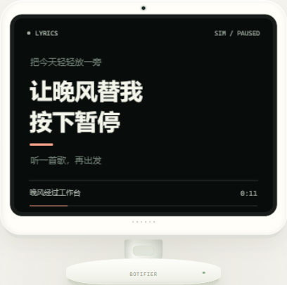

# iPhone / Spotify 同步歌词：可行性与概念预览

调研日期：2026-11-04。范围是播放信息和歌词显示；本目录不连接手机，不调用 Spotify，不更新机器人。

## 看效果

直接打开 [index.html](index.html)，或在仓库根目录启动仅本机可见的静态服务器：

```powershell
py -3.12 -m http.server 8877 --bind 127.0.0.1 --directory demos/lyrics-lab
```

打开 <http://127.0.0.1:8877/>。页面是 **320×240 逻辑屏幕的浏览器概念预览**，使用原创中英文测试歌词和模拟播放时钟。不是 Spotify 实时连接、实际固件渲染或机器人 LCD 实拍。

可体验逐行滚动、播放/暂停、拖动进度、切歌、无歌词、断连，以及护眼、NFC、摸头插播。护眼和 NFC 先开始的完整展示，后来的触发不排队；插播时音乐时钟继续，结束后恢复当前播放位置的歌词。护眼视频与动作是概念占位，不是守岸人3D素材或实体运动验证。按照用户要求，现有高优先级动画/互动在前、歌词其次、普通闲时栏目再次。

屏幕当前句大字显示，前后句降低强调；按行时间戳切换，不假装拥有逐字时间戳。实际部署字体、颜色量化、刷新速度及动画效果须在硬件上验证。



### 预览验证

浏览器中完成47项状态与文字边界断言，覆盖两首原创样例的24个逐行时间点；未发现样例文字超出320×240画布。实际点击、进度滑杆、键盘播放/跳进度，以及1440、768、375px布局已检查，无横向溢出。减少动态时暂停初始播放，手动播放仍走时，关闭转场与机头示意摆动。

受控浏览器时钟检查了护眼片头、动作示意、20秒休息，以及结束恢复当前歌词；这只是原型时序验证。最初在已运行页面中安装虚拟时钟出现一次时间跳变，后续统一时钟后复测通过，保留初始结果；媒体查询事件也须等待浏览器派发后再断言。检查记录与截图在本机忽略目录 `logs/lyrics-lab-*`，不作为实机验收。

固定时间截图可在浏览器控制台调用 `lyricsLab.sampleAt(11000)`。完整模拟接口包括 `getState`、`setPosition`、`setPlaying`、`setTrack`、`setConnected`、`setNoLyrics`、`interrupt('eye'|'nfc'|'touch')`、`finishInterruption` 和 `setReducedMotion`。

后续固件实现与验证记录见 [LYRICS.md](../../LYRICS.md)。本目录保留调研阶段的浏览器效果稿，以下研究结论不代表实机验收。

新增 [firmware-preview.png](firmware-preview.png) 为真实固件歌词页面在桌面 LVGL 中的渲染，使用最终 20px / 1bpp 字库；不是浏览器概念图，也不是机器人 LCD 实拍。

2026-11-05 的新固件动效另见 [firmware-motion.gif](firmware-motion.gif) 和 [静态图](firmware-motion.png)。这是实际生产 LVGL 页面、现有字库与原创样例歌词的 80 帧受控时钟渲染，展示切句上移淡入、播放状态律动及平滑进度。当前句 26px，前后句 14px；过长内容回退 20px。暂停保留歌词并停止动画。它不是网页效果稿，也不是 LCD 录像，不能据此断言设备帧率或实际音乐的歌词对齐。

此前 `firmware-preview.png` 对应的静态页面没有实现网页预览中的动效；这项差距已确认，新动图单独保留生产页面的验证结果。

98 修正版的[实际 LVGL 动图](firmware-motion-98.gif)和[中文静态图](firmware-motion-98.png)使用纯黑背景及保留灰度的字形。当前句只栅格化一次，动画复用其缓存；被歌词盖住的宠物暂停绘制。完整字库仍覆盖 6649 个字符；播放进度与歌词时间戳未改。这些仍是生产页面的桌面渲染，物理 LCD 表现另行验证。

## 结论与推荐路径

**有明确技术路径，尚未完成这台 iPhone + Spotify 的端到端实测。** 推荐先做 BLE 的 Apple Media Service（AMS）读取，再让机器人通过 Wi-Fi 查找同步歌词。电脑不参与日常数据中转，音频输出维持用户自己的手机、耳机或音箱。

```text
iPhone 上的 Spotify
    ↓ iOS Now Playing → BLE / Apple Media Service
歌名、歌手、专辑、时长、播放状态、进度
    ↓ 机器人通过 Wi-Fi / HTTPS 按歌曲匹配
带逐行时间戳的歌词（LRC）
    ↓ 本地播放时钟与暂停/拖动校正
BOTIFIER 歌词画面
```

| 关键问题 | 已有证据 | 当前结论 |
| --- | --- | --- |
| 能否通过蓝牙读取手机播放信息 | Apple AMS 定义 Player / Track 属性，包括歌名、歌手、时长、播放状态、速率和已播放时间 | 协议支持；Spotify 在用户当前 iPhone 上的实际数据完整性待验证 |
| 是否必须接收歌曲音频 | AMS 是媒体信息服务，不依赖 A2DP 音频传输 | 可以按只读媒体信息路线设计，无须把机器人变成音箱 |
| 蓝牙里有没有歌词 | AMS 的公开属性表没有歌词字段 | 需要另行匹配歌词，不能把收到歌名当成收到歌词 |
| 同步时是否要频繁轮询手机 | Apple 提供“最近进度 + 经过时间 × 播放速率”的时钟公式 | 本地走时，收到暂停、切歌、拖动事件时重新校正 |
| 能否自己联网获取歌词 | LRCLIB 提供无需 API key 的公开 HTTPS 接口和 LRC 字段；电脑侧已做两首歌曲查询 | 有可用候选服务；机器人网络可达性、曲库覆盖及时间匹配仍须验证 |
| 当前机器人能否直接显示任意中文歌词 | 默认20px字库仅有206个汉字；已有14px低位深中文字体可用 | 正式实现要补适合歌词字号的字库，不能只改一行 label |

AMS 有时会被 iOS 发布或撤销，Apple 要求关注 GATT Service Changed；连接成功之后仍须区分“服务不可用”“尚无媒体”“数据完整”。当前 BLE 配网与 DANCE 共用一个 NimBLE host，新增 AMS 必须协调现有初始化和回调；不能再次独立初始化同一个 host。

## 已做的独立检查

- 固件源码已启用 NimBLE 的 GATT client/server 和 central/peripheral 编译能力；当前业务没有 AMS 客户端。
- 官方 AMS 属性与同步公式已核对。Moddable 的原作者提供过 ESP32 上 BLE 媒体信息与 HTTPS 联用的实现，证明这类组合已有实现先例；它不是当前 StackChan 固件或本机 Spotify 的验收。
- 电脑侧以 `Botifier/0.1` 标识访问 LRCLIB，顺序请求、间隔300ms，只记录响应元数据和行数，没有保存歌词正文：

| 查询样例 | HTTP | 服务记录时长 | 同步歌词行数 | 本次请求耗时 |
| --- | --- | --- | --- | --- |
| Blinding Lights / The Weeknd，查询时长200s | 200 | 200s | 40 | 1020ms |
| Yellow / Coldplay，查询时长266s | 200 | 267s | 49 | 1000ms |

这只证明此刻电脑能取得这些记录，不证明每首歌都有歌词或机器人网络已通。此前另一首查询虽返回200，但只有一行极短内容；因此不能仅以 HTTP 200 判断歌词可用。实际应按歌曲版本、歌手、时长和有效时间行验证，拒绝把错误版本强行配上。没有同步歌词时显示歌曲信息和明确状态，不编造歌词。

字库审查来自已有源 cmap 和 Xtensa 对象：默认20px字库共800字形，仅206个汉字；现有完整子集14px/1bpp字体对象的只读段为272,058字节，覆盖5258个汉字。现有20px/4bpp完整子集对象的只读段为1,239,353字节，超过最近归档固件的应用槽643,632字节余量。对象大小不等于新增后的最终Flash占用；较大字号低位深字库需要重新生成并重新链接验证。“完整子集”不代表覆盖全部 Unicode。

## 正式实现前的最小实测

1. 机器人与这台 iPhone 配对，只读取 AMS。确认 Spotify 播放、暂停、切歌、拖动时能持续得到完整歌名/歌手/时长/进度；验证锁屏、离开/回到蓝牙范围及耳机使用。
2. 在机器人实际网络中查询公开歌词服务，核对常听歌曲及不同版本的覆盖。实测延迟，再决定缓存与偏移校正参数。
3. 将选定字库和歌词画面放入固件，核对 Flash/RAM、中文缺字、长行换行及显示负载；原 NFC、护眼、摸头、距离提醒优先级分别回归。

本轮仅交付调研与浏览器预览，不以浏览器动画证明实机连接、中文覆盖或 LCD 帧率。

## 主要来源

- [Apple AMS 简介与 GATT 依赖](https://developer.apple.com/library/archive/documentation/CoreBluetooth/Reference/AppleMediaService_Reference/Introduction/Introduction.html)
- [Apple AMS 服务、订阅、截断属性与 Service Changed](https://developer.apple.com/library/archive/documentation/CoreBluetooth/Reference/AppleMediaService_Reference/Specification/Specification.html)
- [Apple AMS 属性与播放时钟公式](https://developer.apple.com/library/archive/documentation/CoreBluetooth/Reference/AppleMediaService_Reference/Appendix/Appendix.html)
- [LRCLIB 官方 API 文档](https://lrclib.net/docs)
- [Moddable 原作者：ESP32 Apple Media Service 客户端](https://moddable.com/blog/ams-client/)
- 本地证据：`StackChan/firmware/main/hal/utils/bleprph/bleprph.c`、`sdkconfig`、`main/CMakeLists.txt`、`managed_components/78__xiaozhi-fonts/src/` 及 `DEVICE_DEPLOYMENT.md`。
